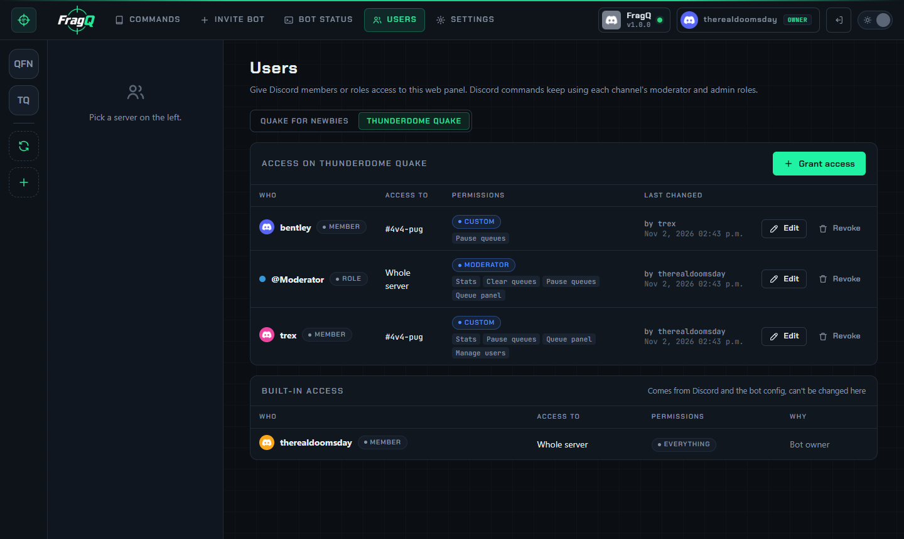
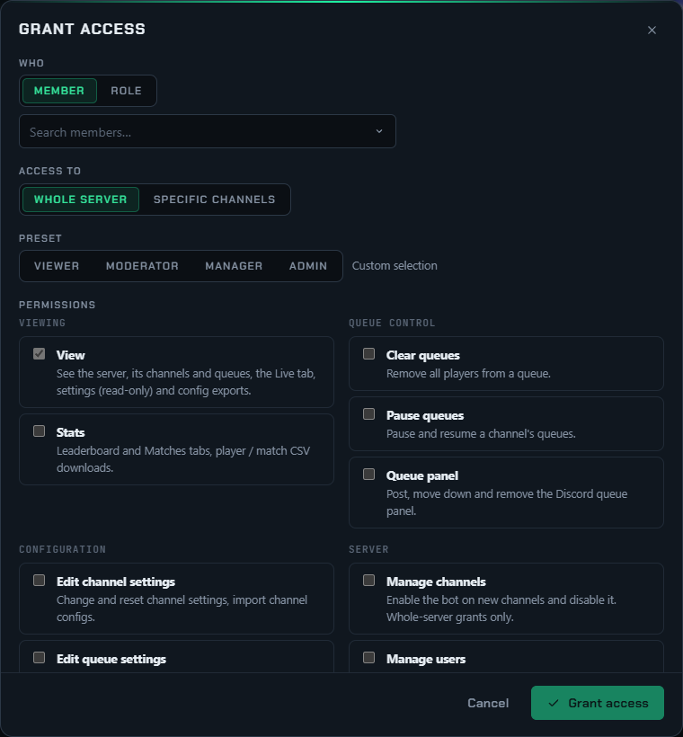

# Web panel access

Who can use the web panel, and what they can do there, is decided per server. Some people have access
automatically; anyone else can be given access on the **Users** page.

!!! note "Web panel only"
    Everything on this page is about the web panel. Discord commands and the queue panel's moderator
    buttons keep using each channel's **Moderator role** and **Admin role**, and so does
    [approving Steam account changes](steam.md#approving-steam-account-changes).

## Built-in access

| Who | Access |
|---|---|
| The bot owner (`DISCORD_OWNER_ID`) | Everything on every server the bot is on, plus the **Bot status** and [Settings](settings-page.md) pages |
| The server owner | Everything on that server |
| Members with Discord's *Administrator* permission | Everything on that server |
| Members with a channel's **Admin role** | Everything on that channel, except *Manage channels*, *Manage users* and *Manage connectors* |

These can't be changed on the Users page; they are listed there under **Built-in access**.

## The Users page

Open **Users** in the top bar, or the **Users** button on a server's overview. Pick the server at the
top. The page lists every grant with its member or role, where it applies, the permissions, and who
changed it last.

{ .shot loading=lazy }

### Give access

1. Press **Grant access**.
2. **Who**: *Member* (search the server's members) or *Role*. A role grant applies to everyone with the
   role, including members who get it later. `@everyone` can't be used.
3. **Access to**: *Whole server*, or *Specific channels* with a checkbox per channel.
4. Pick a **Preset**, then tick or untick individual permissions. *View* is always included.
5. Press **Grant access**.

{ .shot loading=lazy width=760 }

**Edit** changes a grant, **Revoke** removes it. Each member or role has at most one grant per server.

### Permissions

| Permission | Allows |
|---|---|
| **View** *(always on)* | See the server, its channels and queues, the Live tab, settings (read-only) and config exports |
| **Stats** | Leaderboard and Matches tabs, player and match CSV downloads |
| **Clear queues** | Remove all players from a queue |
| **Pause queues** | Pause and resume a channel's queues |
| **Queue panel** | Post, move down and remove the Discord queue panel |
| **Edit channel settings** | Change, reset and import channel settings |
| **Edit queue settings** | Change, reset and import queue settings |
| **Create / delete queues** | Create new queues and delete existing ones |
| **Manage channels** | Enable the bot on new channels and disable it. Whole-server grants only. |
| **Manage users** | Use the Users page, but only to give out permissions they hold themselves, within their own scope |
| **Manage connectors** | Create and change [game connectors](../connectors/index.md) and their keys. Whole-server grants only. |

### Presets

| Preset | Permissions |
|---|---|
| **Viewer** | View, Stats |
| **Moderator** | Viewer + Clear queues, Pause queues, Queue panel |
| **Manager** | Moderator + Edit channel settings, Edit queue settings, Create / delete queues |
| **Admin** | Everything |

## How permissions combine

A member gets **everything that applies to them**: their own grant, plus the grants of all their roles,
plus any built-in access. For example, a member with a server-wide *Viewer* grant who also has a role
with *Manager* on `#4v4-pug` can edit `#4v4-pug` and only view the other channels.

The panel shows only what a member can use: servers and channels without access are hidden, buttons
they can't use are left out, settings without the edit permission are read-only, and the Leaderboard
and Matches tabs need *Stats*. The server checks every request too, so hiding a button is never the
only protection; a refused request names the missing permission.

## Delegating with Manage users

*Manage users* lets moderators hand out access themselves, without being able to give more than they
have:

- They can only grant permissions they hold, on the channels where they hold them, and *Manage users*
  only where they have it.
- A whole-server grant needs *Manage users* on the whole server.
- They can't change their own grant.
- They can't edit or revoke a grant that has more access than they do.

Server admins and the bot owner have no such limits.

## Where grants are stored

In the database table `fragq_web_access`, so they survive restarts and updates and are part of a
[database backup](backup-restore.md). Grants refer to members and roles by id, so renaming a role keeps
its grant. When the bot is disabled on a channel, that channel is removed from all grants.
