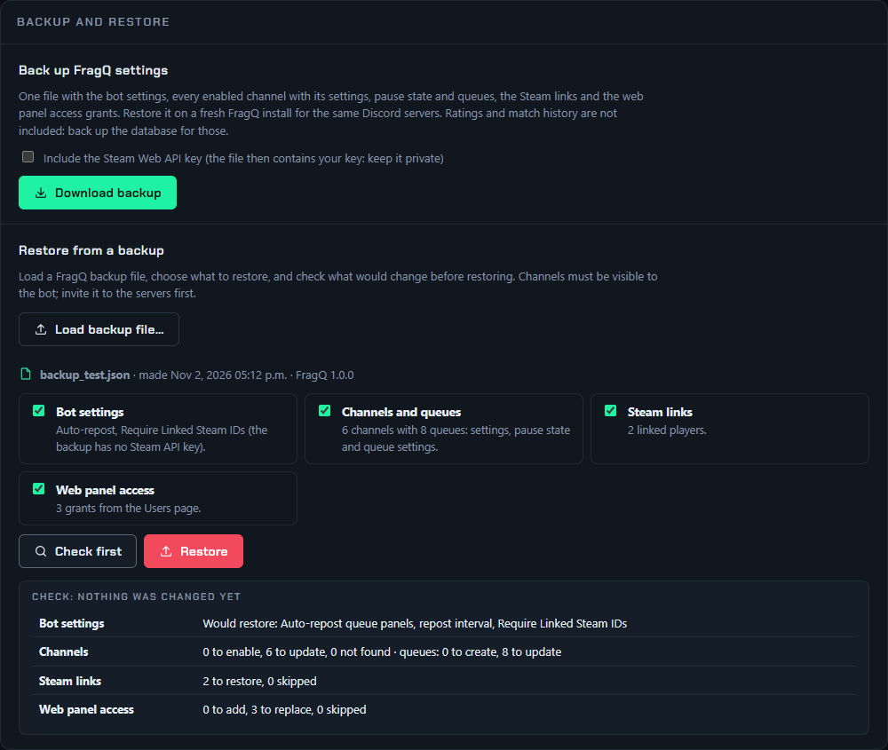

# Backup and restore

FragQ has two kinds of backup:

| | Settings backup | Database backup |
|---|---|---|
| Made with | **Settings → Backup and restore** in the web panel | `mariadb-dump` on the server |
| Contains | Bot settings, channels and queues with their settings, Steam links, web panel access | Everything, including ratings, match history and player stats |
| Good for | Setting up a fresh FragQ install, copying the configuration to another instance | Full backups, moving everything to another server |

## Settings backup

The bot owner finds it at the bottom of the [Settings page](settings-page.md).

{ .shot loading=lazy }

### Download

Press **Download backup** to save `fragq-backup-<date>.json`. It contains:

- the bot settings: *Require Linked Steam IDs* and, only if you tick **Include the Steam Web API key**,
  the key;
- every channel the bot is enabled on: its settings, whether it is paused, and each queue with its
  settings;
- the Steam links;
- the web panel access grants from the [Users page](access.md);
- the [game connectors](../connectors/index.md), with their key hashes, so game servers keep working
  with their current keys.

Not included: ratings, match history and player stats (use a [database backup](#back-up-the-database)),
the queue panels themselves, and pending Steam account changes. Channels, roles and members are stored
by their Discord ids.

!!! warning "Keep it private"
    The file lists your members' Steam accounts, and the Steam API key if you included it.

### Restore

1. Install FragQ and invite the bot to the same Discord servers. A restore can only set up channels the
   bot can see.
2. On the Settings page, press **Load backup file…** and pick the file. FragQ shows when and where it
   was made, and what it contains.
3. Untick anything you don't want: **Bot settings**, **Channels and queues**, **Steam links**,
   **Web panel access**.
4. Press **Check first** to see what would happen without changing anything: channels to enable or
   update, queues to create or update, links and grants to add, and anything that will be skipped
   (for example a channel the bot can't see, or a setting that refers to a deleted role).
5. Press **Restore** and confirm.
6. Post the queue panels again on each channel page, or with `!panel`.

A restore never deletes anything. Channels from the backup are enabled if needed and get the backup's
settings; queues are matched by name, created if missing and updated otherwise; queues and channels that
aren't in the backup are left alone. Steam links and access grants are added, or replace the existing
one for the same member or role. Restoring the same file twice gives the same result.

## What to back up

| What | Where | Contents |
|---|---|---|
| **The database** | volume `fragq_db_data` | Channel and queue configs, ratings, match history, Steam links, web panel access, bot settings. **This is what matters.** A [settings backup](#settings-backup) covers the configuration part. |
| `.env` | the FragQ folder | Your settings and secrets |
| `certs/` | the FragQ folder | Only with `TLS_MODE=custom` |
| Bot data | volume `fragq_fragq_data` | Saved queue and match state, logs, the session key, the avatar cache. Nice to have; all of it rebuilds itself. |
| Certificates | volume `fragq_caddy_data` | Caddy requests new ones if lost |

## Back up the database

In the FragQ folder:

```bash
docker compose exec db sh -c 'mariadb-dump -u root -p"$MARIADB_ROOT_PASSWORD" "$MARIADB_DATABASE"' > backups/fragq.sql
```

`backups/fragq.sql` is a plain SQL file. Copy it, together with `.env`, somewhere safe. To keep several,
put the date in the name:

```bash
docker compose exec db sh -c 'mariadb-dump -u root -p"$MARIADB_ROOT_PASSWORD" "$MARIADB_DATABASE"' > "backups/fragq-$(date +%F).sql"
```

On Linux, a cron job makes this automatic, for example every night at 04:00:

```cron
0 4 * * * cd /home/me/fragq && docker compose exec -T db sh -c 'mariadb-dump -u root -p"$MARIADB_ROOT_PASSWORD" "$MARIADB_DATABASE"' > "backups/fragq-$(date +\%F).sql"
```

## Restore

Put the dump in `backups/` (mounted into the database container as `/backups`), then:

```bash
docker compose stop app
docker compose exec db sh -c 'mariadb -u root -p"$MARIADB_ROOT_PASSWORD" "$MARIADB_DATABASE" < /backups/fragq.sql'
docker compose start app
```

## Move to another server

1. On the old server: back up the database and copy `.env` (and `certs/` if you use your own).
2. On the new server: clone or extract FragQ, put `.env` in its folder and the dump in `backups/`.
3. Start only the database, restore, then start everything:

    ```bash
    docker compose up -d db
    docker compose exec db sh -c 'mariadb -u root -p"$MARIADB_ROOT_PASSWORD" "$MARIADB_DATABASE" < /backups/fragq.sql'
    docker compose up -d --build
    ```

4. If the address changed, update `SITE_HOST` and `PUBLIC_URL` in `.env`, and the OAuth2 redirect in the
   Discord developer portal.

Stop the old FragQ before starting the new one: two copies with the same bot token fight over the
Discord connection.
