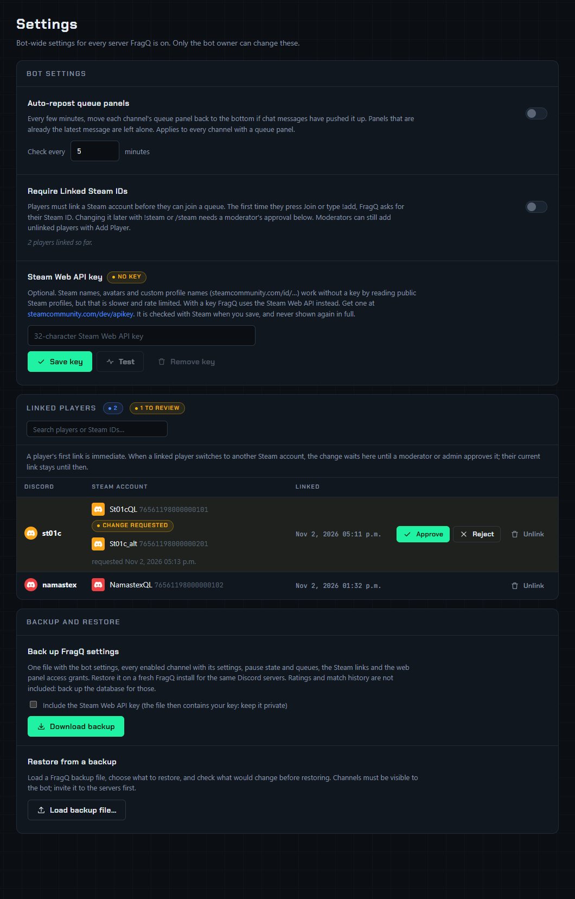

# Settings page

**Settings** in the top bar holds the bot-wide settings: they apply to every server the bot is on.

| Who | What they see |
|---|---|
| The bot owner (`DISCORD_OWNER_ID`) | Everything below |
| Server admins and members with a channel's **Admin role** or **Moderator role** | Only **Linked players**, to [review Steam account changes](steam.md#approving-steam-account-changes) of members of their servers |

When Steam account changes are waiting for someone, the **Settings** link in the top bar shows how many.

{ .shot loading=lazy }

## Bot settings

The settings save as soon as you change them.

### Auto-repost queue panels

Off by default. When it's on, FragQ checks every channel's [queue panel](../queue-panel/panel.md) every
few minutes (**Check every … minutes**, 5 by default, 1 to 1440). If chat messages have pushed the panel
up, FragQ moves it back to the bottom of the channel by posting it again. A panel that is still the
latest message is left alone, so quiet channels don't get reposts.

This comes on top of each channel's *Keep queue panel at the bottom* setting, which reposts the panel
below every match start message.

### Require Linked Steam IDs

Players must link a Steam account before they can join a queue. See
[Steam integration](steam.md#require-linked-steam-ids).

### Steam Web API key

Optional; makes Steam lookups faster. See [Steam integration](steam.md#steam-web-api-key).

## Linked players

Every Steam link, with pending changes at the top and **Approve**, **Reject** and **Unlink** buttons.
See [Steam integration](steam.md#linked-players).

## Backup and restore

A single file with all FragQ settings, to move them to a fresh install. See
[Backup and restore → Settings backup](backup-restore.md#settings-backup).
