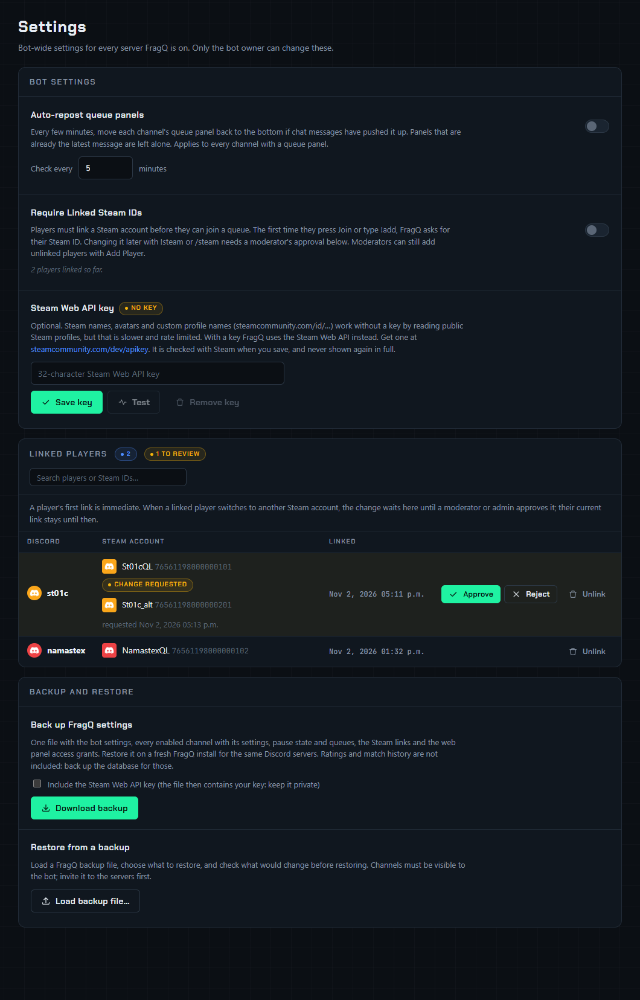

# Settings page

**Settings** in the top bar holds the bot-wide settings: they apply to every server the bot is on.

| Who | What they see |
|---|---|
| The bot owner (`DISCORD_OWNER_ID`) | Everything below |
| Server admins and members with a channel's **Admin role** or **Moderator role** | Only **Linked players**, to [review Steam account changes](steam.md#approving-steam-account-changes) of members of their servers |

When Steam account changes are waiting for someone, the **Settings** link in the top bar shows how many.

On a wide screen the panels sit in two columns: **Bot settings** and **Fragdex**, then **Slipgate** and
**Backup and restore**, with **Linked players** across the full width below. On a narrow screen they are
stacked.

{ .shot loading=lazy }

## Bot settings

The settings save as soon as you change them.

!!! note "Auto-repost queue panels moved"
    FragQ 1.0.0 had **Auto-repost queue panels** here, for every channel at once. It is now
    **Auto-refresh panel** on each channel's **Settings → General** tab (see
    [Keep it visible](../queue-panel/panel.md#keep-it-visible)). If it was on, every channel was
    switched on with the same number of minutes when you updated.

### Steam Web API key

Optional; makes Steam lookups faster. The badge at the top right of the panel says whether a key is saved. See [Steam integration](steam.md#steam-web-api-key).

### Require Linked Steam IDs moved

It is a queue setting now (queue **Settings → General**), so each queue decides. The panel says so and shows
how many players are linked. See [Steam integration](steam.md#require-linked-steam-ids).

## Fragdex

FragQ can ask a [Fragdex](https://d00msdaydevice.github.io/fragdex/) server for the Discord account of a
Steam ID that nobody linked in FragQ. It is a convenience for game servers, and off until you turn it on.

1. In Fragdex, open **Settings → Fragdex API**. Copy the **Base URL** (such as
   `https://fragdex.example.com/api/v1`) and create a key for FragQ. It only needs to read players, so leave
   **See IP addresses**, **See notes**, **Add records** and **Game server** off. If FragQ always connects from
   the same address, put it in the key's **Allowed IPs**.
2. On FragQ's Settings page, enter the **Base URL** and the **API key** in the **Fragdex** panel. The Fragdex
   site's address alone (`https://fragdex.example.com`) works too.
3. Press **Save**. FragQ saves both and tests them. **Test** checks what's in the boxes without saving it
   (empty boxes test the saved settings). After a passing test, press **Save** to keep what you tested.
4. Once the test passes, the panel shows **Connected** and **Lookup unknown IDs using Fragdex** can be used.
   It starts at **OFF** (red). Press **ON** (green) to turn lookups on.

Until a connection passes a test, both **OFF** and **ON** are greyed out. Saving a different address or key turns
lookups off again, until the new settings pass a test and you press **ON**. **Remove** forgets the address and
key.

### What a lookup does

When a game server sends Steam IDs, FragQ first uses its own links. It asks Fragdex only about the Steam IDs
nobody linked in FragQ, and uses an answer only if it is the Discord ID of a member of the server the game
server's connector belongs to.

| Where | With a Fragdex lookup |
|---|---|
| [Posted results](../connectors/index.md#what-a-posted-result-looks-like) | The player shows with their Discord name |
| [Check linked players](../connectors/result-format.md#requests) | The player counts as linked; the answer says `"fragdex": true` |
| [Voice moves](voice.md) | The player is moved like a linked player; the answer says `"fragdex": true` |

What Fragdex says is never saved as a link in FragQ, never counts as verified, isn't sent back to Fragdex
through a [Fragdex connector](../connectors/index.md#connect-fragdex), and never affects ratings or which FragQ
match a result belongs to. Players who want a real link still use `!steam`, `!link` or the `/verify` page.

FragQ remembers each answer for 10 minutes (5 for a Steam ID Fragdex doesn't know), and waits at most 3
seconds for Fragdex, so a slow or unreachable Fragdex never holds up a game server. The panel shows how many
players were found since FragQ started, and the last failed lookup.

## Slipgate

A Slipgate API key lets queues balance teams with Slipgate ratings and gives new players a starting rating
from Slipgate. See [Slipgate](slipgate.md).

## Linked players

Every Steam link, with pending changes at the top and **Approve**, **Reject** and **Unlink** buttons.
See [Steam integration](steam.md#linked-players).

## Backup and restore

A single file with all FragQ settings, to move them to a fresh install. See
[Backup and restore → Settings backup](backup-restore.md#settings-backup).
