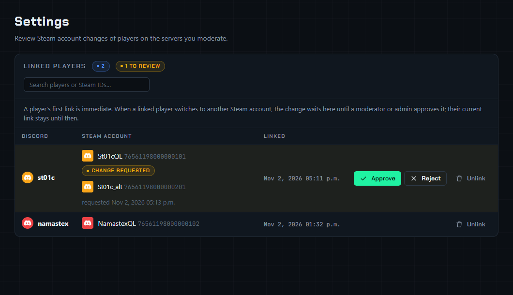

# Steam integration

FragQ can link Discord members to Steam accounts. Linked players show their Steam avatar on the
[queue panel](../queue-panel/panel.md), and you can require a link before anyone joins a queue. The
settings are on the [Settings page](settings-page.md) and apply to every server the bot is on. Only the
bot owner (`DISCORD_OWNER_ID`) can change them; moderators and admins can review Steam account
changes there.

## Steam Web API key

A key is **optional**. Without one, FragQ reads public Steam community profiles to find names and
avatars and to resolve custom profile URLs. That works, but it is slower and Steam rate-limits it, so
FragQ refreshes at most 10 profiles every half hour. With a key FragQ uses the Steam Web API instead,
100 profiles at a time.

1. Sign in at <https://steamcommunity.com/dev/apikey> with any Steam account and register a key. The
   domain name you enter there doesn't matter.
2. On the FragQ **Settings** page, paste the 32-character key and press **Save key**. FragQ checks it
   with Steam first and refuses a key that doesn't work.
3. **Test** checks the saved key again. **Remove key** goes back to reading public profiles.

After saving, the key is never shown in full again; the page only shows its last characters. It is
stored in the database.

## Require Linked Steam IDs

With this switch on, players must link a Steam account before they can join a queue. The first time an
unlinked player presses **Join** or uses `/add`, FragQ shows a form asking for their Steam ID or profile
link; for `!add` and `++` it replies with a **Link Steam** button that opens the form. Once linked, the
join goes through. See [Linking Steam](../playing/steam.md) for what players see.

- [Moderators can still add](../queue-panel/moderators.md#add-player) players who haven't linked.
- With the switch off, linking is voluntary and nobody is asked.

## How a link was made

Typing a Steam ID proves nothing: anyone can paste someone else's. FragQ records how each link was made
and shows it in **Linked players**:

| Shown | How it was made |
|---|---|
| **Claimed** | Typed in with `!steam`, `/steam` or the pop-up form. All links from before this feature are claimed. |
| **In-game** | `!link` on a game server, confirmed in a Discord direct message |
| **Steam proven** | The player signed in through Steam on the `/verify` page |

Running `!steam` again on the same account never lowers this.

## The /verify page

Players prove an account at `PUBLIC_URL/verify`, such as `https://fragq.example.com/verify`. They sign in
with Discord, then through Steam. FragQ never sees their Steam password; Steam only tells it which account
signed in. The page needs `PUBLIC_URL` in [`.env`](env.md) and says so if it isn't set. There is nothing to
add in the Discord developer portal: the login uses the redirect you already have.

FragQ links the page in the **Link Steam** prompt and in the reply to `!steam`. What the proof does:

| Situation | Result |
|---|---|
| The player has no link, or is already linked to this account | Linked and marked **Steam proven** |
| Another member has only **claimed** this account | Their link is removed and they get a direct message; the player is linked |
| Another member has **proved** this account (Steam or in-game) | Refused. An admin has to sort it out. |
| The player is linked to a different account | A change request, marked **Steam proven**, for a moderator to approve |

## Approving Steam account changes

A player's **first** link is immediate. After that, switching to **another** Steam account with
`!steam` or `/steam` is a request: the player keeps their current link, and the change waits for a
moderator or admin.

{ .shot loading=lazy }

On the Settings page, pending changes are listed first in **Linked players**, highlighted, with the
current account and the requested one:

- **Approve** links the player to the requested account.
- **Reject** keeps the current link.

Either way, FragQ sends the player a direct message with the outcome (if their DMs are open).

Who can review:

| Who | Whose changes |
|---|---|
| The bot owner | Everyone's, including their own |
| Server owners and members with Discord's *Administrator* permission | Members of that server |
| Members with a channel's **Admin role** or **Moderator role** | Members of that channel's server |

Nobody but the bot owner can approve their own change; another moderator has to. Web panel grants from
the [Users page](access.md) don't give this right; it follows the Discord roles, like the moderator
commands do.

Other rules:

- A new request replaces the player's previous pending one. Submitting their current account again
  cancels it.
- If someone else has linked the requested account in the meantime, **Approve** refuses; reject the
  request, or unlink the other member first. The exception is a **Steam proven** request for an account
  another member has only claimed: approving it removes that claim and tells the member.
- **Unlink** also drops a pending change.

## Linked players

The **Linked players** table lists every link: the Discord member, the Steam name and avatar, the
SteamID64 (a link to the profile), [how it was made](#how-a-link-was-made) and when it was linked. Search by name or Steam ID. Moderators and
admins only see members of their own servers.

**Unlink** removes a link, for example when someone linked an account that isn't theirs. One Steam
account can only be linked to one Discord member, so the rightful owner can then link it.

## Data

| What | Where |
|---|---|
| Links: Discord id, SteamID64, Steam name, avatar URL, profile URL, dates | Database table `fragq_steam_links` |
| Pending changes | Database table `fragq_steam_requests` |
| The API key and *Require Linked Steam IDs* | Database (bot settings) |
| Downloaded avatar pictures | Data volume, `/data/avatars`, deleted after 30 days unused |

Steam names and avatars are refreshed every 3 days, so changes on Steam show up on their own.
