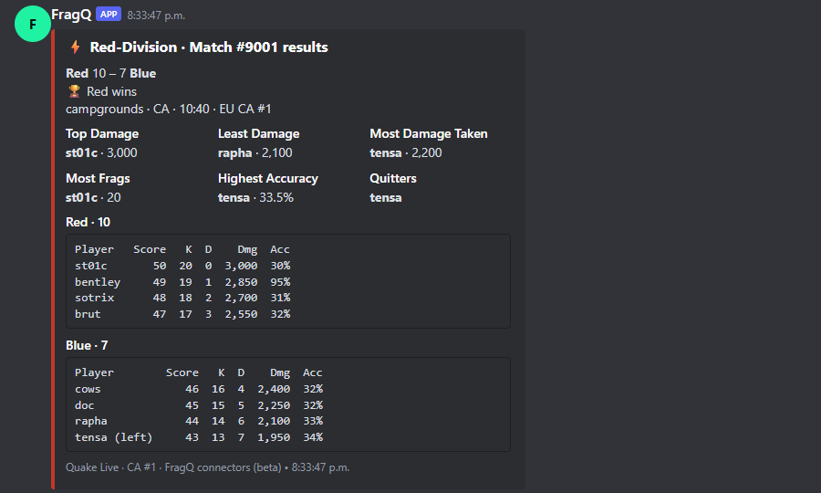
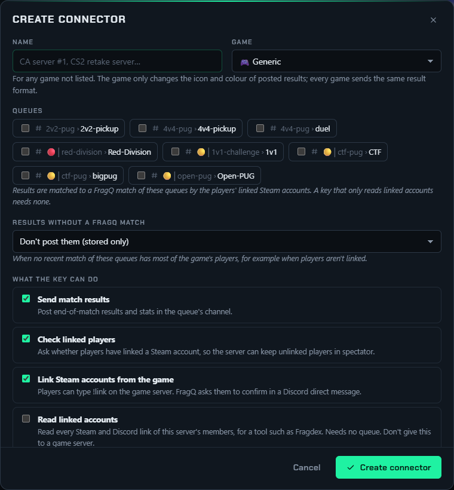
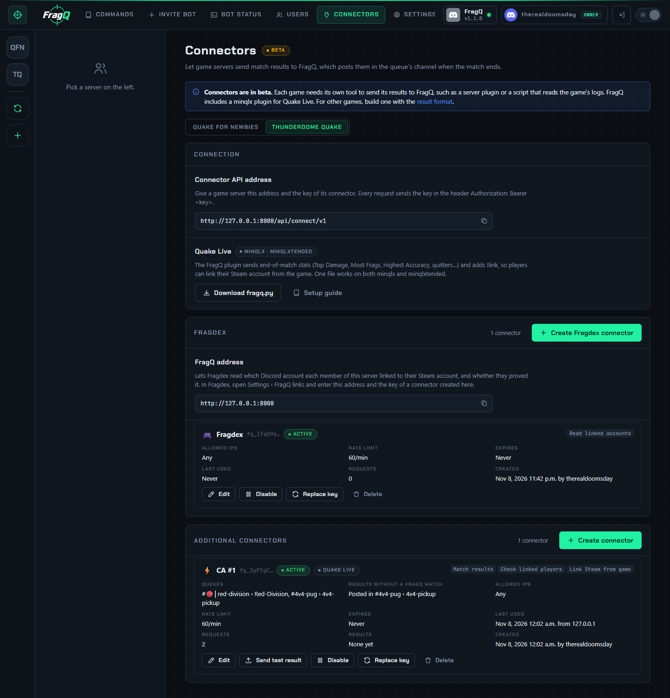

# Game connectors

A **connector** lets a game server send its match results to FragQ. When a match ends, the game server
sends the score, the players and their stats, and highlights such as *Top Damage*. FragQ finds the
pickup match those players were in and posts the results in the queue's Discord channel.

!!! warning "Beta"
    Connectors are in beta. Each game needs its own tool to send its results to FragQ, such as a server
    plugin or a script that reads the game's logs. FragQ includes a [minqlx plugin for Quake Live](quake-live.md).
    For any other game, build a tool with the [result format](result-format.md).

FragQ doesn't need to know the game. Every game sends the same kind of document, and FragQ shows
whatever it is given: Quake Live sends *Most Frags* and *Highest Accuracy*, a Counter-Strike 2 tool
could send *Most Headshots* and *Clutches*, without any change to FragQ.

## What a posted result looks like

The result is posted in the channel of the queue the match was played in, with:

- the title: queue name and match number, such as *Red-Division · Match #9024 results*;
- the score, the winner, the map, mode, length and server;
- the highlights, side by side;
- a table per team with the stats columns the game chose;
- players named by their Discord name when they have linked their Steam account, otherwise by
  their in-game name. Nobody is pinged.

The queue panel moves below the result, as it does after a match message.

{ .shot loading=lazy width=640 }

## Create a connector

You need the **Manage connectors** permission (see [Web panel access](../administration/access.md)),
or be a server admin.

1. Open **Connectors** in the top bar and pick the server.
2. Press **Create connector**.
3. Fill in the form:

    { .shot loading=lazy width=640 }

    | Field | What it does |
    |---|---|
    | **Name** | Anything that tells connectors apart, such as *CA server #1* |
    | **Game** | Generic, Apex Legends, Battlefield 6, Counter-Strike 2, Overwatch 2 or Quake Live. It sets the icon and colour of posted results; the format is the same for every game. Use **Generic** for anything not listed. |
    | **Queues** | The queues this game server plays. A connector can serve several queues, and a queue can have several connectors. A key that only reads linked accounts needs none. |
    | **Results without a FragQ match** | Where results go when FragQ can't find the match (see below): one of the connector's queues, or nowhere (stored only) |
    | **What the key can do** | *Send match results*, *Check linked players* and *Link Steam accounts from the game*. Untick what the game server doesn't need. *Read linked accounts* is off by default and is for tools such as Fragdex, not game servers: it reads every Steam and Discord link of this server's members. |
    | **Rate limit** | Requests per minute, 60 by default. 0 = unlimited. |
    | **Expires** | The last day the key works (UTC). Empty = never. |
    | **Allowed IPs** | IP addresses or ranges the key may be used from, one per line, such as `203.0.113.10` or `198.51.100.0/24`. Empty = any address. Use the game server's public address. |

4. Press **Create connector**. The page shows the **key** once, with a `curl` command to test it.
   Copy it now: FragQ only keeps a hash of it.

Give the game server the **Connector API address** shown at the top of the page, and the key.

## Connect Fragdex

[Fragdex](https://d00msdaydevice.github.io/fragdex/) can read which Discord account each member linked to their
Steam account, and whether they proved it. It has its own **Fragdex** panel on the Connectors page:

1. Press **Create Fragdex connector**. It only needs a name, and can only read linked accounts.
2. Copy the key. It is shown once.
3. In Fragdex, open **Settings → FragQ links** and enter the **FragQ address** from the panel and the key.

Keys with only the *Read linked accounts* permission are listed in this panel. All other connectors are
under **Additional Connectors**.

## Manage connectors

{ .shot loading=lazy }

Each connector shows its settings, when it was last used and from where, how many requests and
results it has had, and the last refused request with the reason (wrong IP, expired, disabled, or
something the key isn't allowed to do).

| Button | What it does |
|---|---|
| **Edit** | Change any setting. The key stays the same. |
| **Send test result** | Posts a made-up result, marked as a test, in the connector's channel, so you can see what results look like. Not on Fragdex connectors. |
| **Disable** / **Enable** | Refuse the key for now without deleting the connector |
| **Replace key** | A new key with the same settings. The old key stops working immediately. Do this if a key leaks. |
| **Delete** | Remove the connector and its key. Results already posted stay in Discord. |

## How a result finds its match

The game server doesn't know FragQ's match number, so FragQ works it out:

1. FragQ looks at the matches of the connector's queues from the last 6 hours, including matches still
   waiting for a result report.
2. It turns the game's players into Discord members through their [linked Steam accounts](../playing/steam.md).
3. A match qualifies when at least half of its players are in the game's result. The one with the
   biggest share wins. When two qualify equally, a match without a result yet comes first, then the most
   recent one.

If no match qualifies, the result goes where **Results without a FragQ match** says. It is still stored.

!!! tip "Link everyone's Steam account"
    Matching works best when every player is linked. Turn on **Require Linked Steam IDs** on the
    [Settings page](../administration/settings-page.md), or let players link from the game with
    [`!link`](quake-live.md#link).

A tool that knows the FragQ match number can send it as `fragq_match_id`, and FragQ uses that match
instead. A game server sending the same result twice (with the same `match_uid`) gets it posted
once.

## Linking Steam accounts from the game

With *Link Steam accounts from the game*, a game server can link its players' Steam accounts to
Discord. The game server knows the player's real Steam account; the player names their Discord
account. FragQ then sends that member a direct message:

> **st01c** on **CA server #1** (Quake Live) asked to link the Steam account `76561198…` to your
> Discord account on **Thunderdome**. Only confirm if that was you.

The member presses **Confirm** (or **That wasn't me**) within 15 minutes. The usual rules apply:

- the first link is immediate;
- changing an existing link needs a [moderator's approval](../administration/steam.md#approving-steam-account-changes);
- a Steam account already linked to someone else is refused.

If the member doesn't accept direct messages from server members, the game server says so, and they
can link with `!steam` in Discord instead.

## Backups

Connectors are part of the [Settings backup](../administration/backup-restore.md#settings-backup),
with their key hashes. After restoring on a new install, game servers keep working with their
current keys once you point them at the new address.
