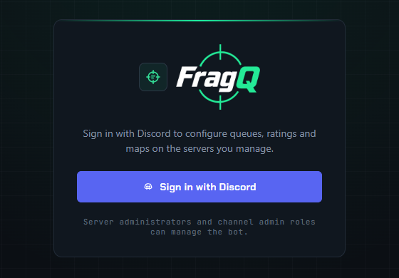
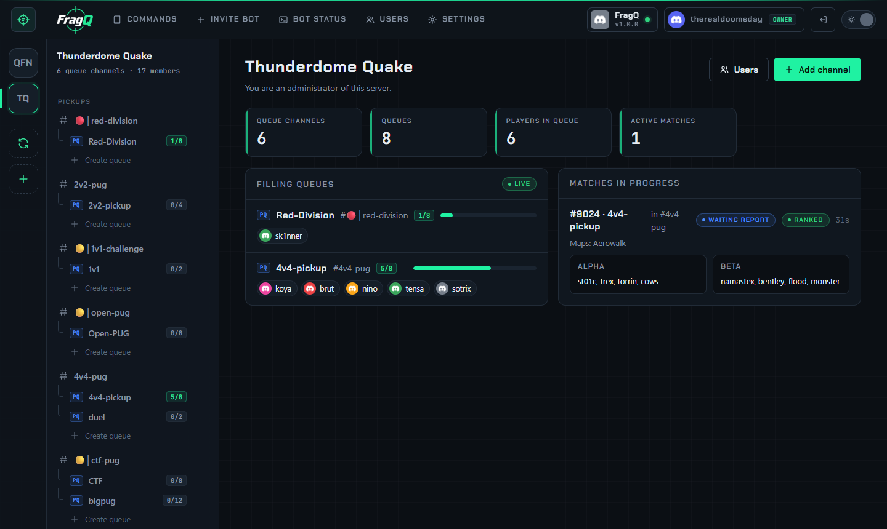
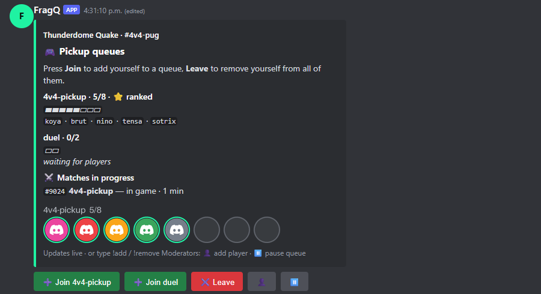

# First channel and queue

## 1. Sign in

Open the web panel and press **Sign in with Discord**. Discord only shares your username and avatar
(the `identify` scope). FragQ then shows the servers where the bot can see that you are an admin, hold
a channel's admin role, or were given access on the [Users page](../administration/access.md).

{ .shot loading=lazy width=560 }

## 2. Invite the bot

Press **Invite bot** in the top bar, pick your server and approve. The bot asks for:

| Permission | Used for |
|---|---|
| Send Messages, Embed Links | Replies, the queue panel, check-in and match messages |
| Attach Files | The row of player avatars on the queue panel |
| Add Reactions | Check-in (☑ / ⛔) and map votes |
| Read Message History, Manage Messages | Updating, moving and cleaning up its own messages |
| Manage Roles | Rank roles and promotion roles |
| Manage Channels | The same as PUBobot2 |

The server then shows up in the rail on the left.

!!! note "Bot already on the server?"
    Embed Links and Attach Files were added to the invite in FragQ 1.0.0. If the bot joined with an
    older link, give its role those two permissions in **Server Settings → Roles**, or invite it again
    with the new link (it stays on the server and keeps everything).

!!! note "Rating prefixes in nicknames"
    The channel setting *Set ratings to nicks* (`rating_nicks`) also needs **Manage Nicknames**, which
    the invite link doesn't ask for. Give the bot's role that permission in Discord if you turn it on.

## 3. Enable a channel

Select the server in the rail, then choose **Add channel** in the channel tree and pick a text channel.
FragQ is now active there. You can also type `!enable_pubobot` in the channel itself, as with
PUBobot2, or use `/channel enable`.

{ .shot loading=lazy }

On the channel's **Settings** tab, set at least:

- **Admin role** (`admin_role`): members who may change the bot's settings and use every moderation
  command.
- **Moderator role** (`moderator_role`): members who may use moderation commands, such as adding and
  removing players, cancelling matches and the panel's moderator buttons.

The server owner and members with Discord's *Administrator* permission always count as admins.

## 4. Create a queue

Press **Create queue**, enter a name such as `4v4-pickup` and the number of players, for example `8`.
Then open the queue in the tree and adjust it. The most important settings:

| Setting | What it does |
|---|---|
| **is ranked** (`ranked`) | Turn on ratings, result reports and the leaderboard for this queue |
| **Require check-in** (`check_in_timeout`) | How long players have to confirm with `!ready` once the queue is full |
| **Pick teams** (`pick_teams`) | `draft`, `matchmaking` (balanced by rating), `random teams` or `no teams` |
| **Maps** (`maps`) and **Map count** | The map pool and how many maps to show |
| **Server** (`server`) | The address and password printed when the match starts |

Every setting is listed in [Queue settings](../reference/queue-settings.md). In chat, the same can be
done with `/queue create_pickup` and `/queue set`.

## 5. Post the queue panel

Press **Post queue panel** on the channel page, or type `!panel` in the channel. FragQ posts a message
with a **Join** button per queue and a **Leave** button, and keeps it updated. See
[The queue panel](../queue-panel/panel.md).

{ .shot loading=lazy width=600 }

## 6. Play

Players press **Join** or type `++`. When the queue fills, FragQ starts the check-in. Try it with a few
friends, or read [Joining queues](../playing/joining.md) and [Matches](../playing/matches.md) first.

## Next steps

- Give moderators access to the web panel: [Web panel access](../administration/access.md).
- Link Steam accounts, optionally required: [Steam integration](../administration/steam.md).
- Copy your setup to other channels: [Import and export](../web-panel/import-export.md).
