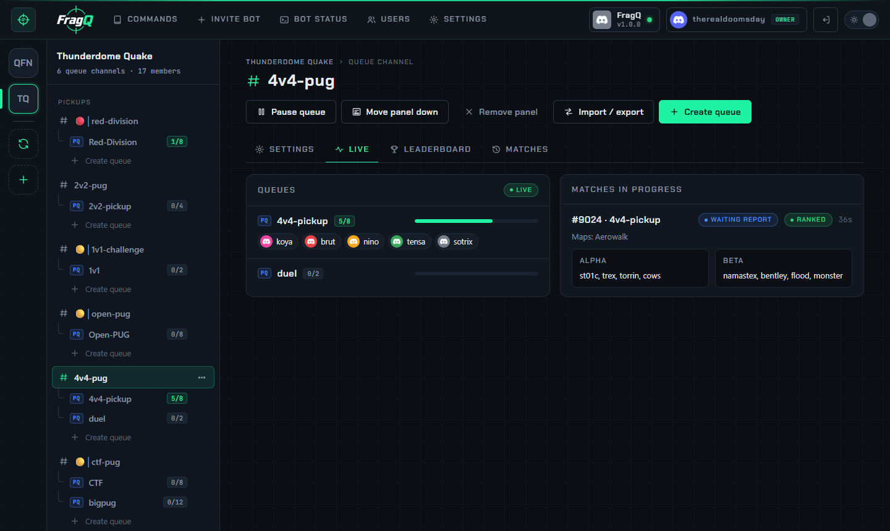

---
hide:
  - navigation
---

# FragQ: pickup games on Discord

{ .hero-logo }
{ .hero-logo }

**FragQ is a self-hosted Discord bot for pickup games, with a web control panel.** Players join queues
from a button panel or with `!add` and `++`. When a queue fills, FragQ runs the check-in, picks
captains, hosts the draft or balances the teams by rating, chooses the maps and posts the server
address. Ranked queues keep ratings with TrueSkill, Glicko2 or flat points, assign rank roles, and keep
a leaderboard and full match history.

{ .shot loading=lazy }

FragQ is a fork of [PUBobot2](https://github.com/Leshaka/PUBobot2) by Leshaka. It keeps PUBobot2's
commands and database unchanged and adds:

- a web panel for every setting, with import and export, live queues, leaderboards and CSV downloads;
- a Discord queue panel with Join and Leave buttons, player avatars and moderator buttons;
- Steam account linking;
- game connectors (beta): game servers post end-of-match stats in the queue's channel, starting with a
  minqlx plugin for Quake Live;
- a Users page that gives members or roles access to the web panel;
- Docker deployment with automatic HTTPS.

[Install FragQ](getting-started/installation.md){ .md-button .md-button--primary }
[What is FragQ?](getting-started/introduction.md){ .md-button }

## Start here

<div class="grid cards" markdown>

-   :material-application-cog-outline: **[Discord application](getting-started/discord-app.md)**

    ---

    Create the bot in the Discord developer portal: token, intents, client secret and the login redirect.

-   :material-download-box-outline: **[Installation](getting-started/installation.md)**

    ---

    One interactive installer for Linux or Windows: MariaDB, the bot and automatic HTTPS in Docker.

-   :material-format-list-checks: **[First channel and queue](getting-started/first-steps.md)**

    ---

    Invite the bot, enable it on a channel, create a queue and post the queue panel.

-   :material-gesture-tap-button: **[The queue panel](queue-panel/panel.md)**

    ---

    Join and Leave buttons, player avatars, and moderator buttons to add players or pause the queue.

</div>

## Core topics

- **Playing**: [Joining queues](playing/joining.md), [Matches](playing/matches.md), [Ratings and leaderboard](playing/ratings.md), [Linking Steam](playing/steam.md).
- **Web panel**: [Navigating the panel](web-panel/overview.md), [Channel and queue settings](web-panel/settings-editor.md), [Live, leaderboard and matches](web-panel/live-and-stats.md), [Import and export](web-panel/import-export.md).
- **Connectors (beta)**: [Game connectors](connectors/index.md), [Quake Live (minqlx)](connectors/quake-live.md), [Result format](connectors/result-format.md).
- **Reference**: [Commands](reference/commands.md), [Channel settings](reference/channel-settings.md), [Queue settings](reference/queue-settings.md).
- **Administration**: [Web panel access](administration/access.md), [Settings page](administration/settings-page.md), [Steam integration](administration/steam.md), [.env reference](administration/env.md), [HTTPS and ports](administration/https.md), [Moving from PUBobot2](administration/pubobot2.md), [Updating](administration/updating.md), [Backup and restore](administration/backup-restore.md).

## Install

**Linux** server with Docker and the Compose plugin:

```bash
git clone https://github.com/D00MSDAYDEVICE/fragq.git && cd fragq
./deployfragq.sh
```

**Windows** host with Docker Desktop running:

```powershell
git clone https://github.com/D00MSDAYDEVICE/fragq.git; cd fragq
powershell -ExecutionPolicy Bypass -File .\deployfragq.ps1
```

You need a Discord application first; see [Discord application](getting-started/discord-app.md). See
[Installation](getting-started/installation.md) for requirements and every option.

## Links

- Repository: <https://github.com/D00MSDAYDEVICE/fragq>
- Issues and feature requests: <https://github.com/D00MSDAYDEVICE/fragq/issues>
- The original PUBobot2: <https://github.com/Leshaka/PUBobot2>
