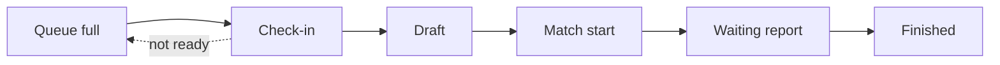
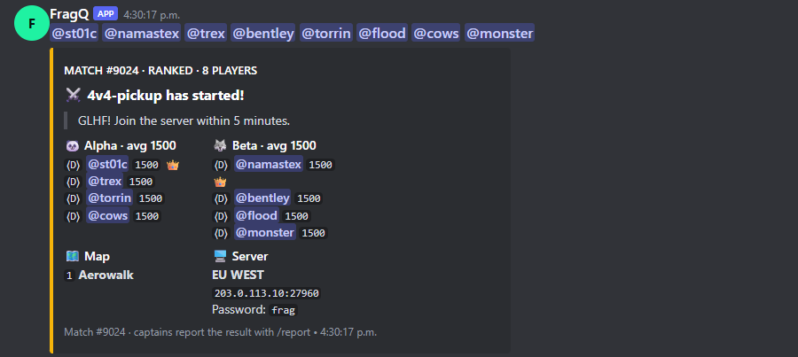

# Matches

When a queue is full (and **Start when full** is on), FragQ turns the players into a match. A match goes
through these stages; which ones apply depends on the [queue settings](../reference/queue-settings.md).

## Check-in

With **Require check-in** (`check_in_timeout`) set, FragQ posts a check-in message and pings the players.
Each player confirms within the time limit:

| Action | Command | Reaction |
|---|---|---|
| I'm ready | `!ready` / `!r` / `/ready` | ☑ |
| I'm not ready | `!notready` / `!nr` / `/notready` | ⛔ |
| Vote for a map | | 1️⃣ 2️⃣ 3️⃣ … (when **Vote poll map count** is set) |

Players who aren't ready in time are removed and the others go back into the queue, which waits for
replacements. With **Allow discard check-in** a player can drop out with ⛔; **Check-in discard
immediately** decides whether that cancels the check-in right away.

`!auto_ready 30m` (or `/auto_ready`) confirms your next check-in automatically, for up to the
channel's **Auto ready limit** (`max_auto_ready`).

## Teams

**Pick teams** (`pick_teams`) decides how teams are made:

| Value | How |
|---|---|
| `draft` | Two captains pick players in turn, following **Teams picking order** (`abababba` by default) |
| `matchmaking` | FragQ balances the teams by rating |
| `random teams` | Random teams |
| `no teams` | Just a list of players |

During a draft:

| Command | What it does |
|---|---|
| `!pick <player>` / `!p` / `/pick` | The captain whose turn it is picks a player |
| `!capme` / `/capme` | Give up your captain spot |
| `!capfor <team>` / `/capfor` | Become captain of a team |
| `!teams` / `/teams` | Show the teams so far |

**Pick captains** (`pick_captains`) decides who the captains are: by captain role and rating, a fair
pair with close ratings, random, or nobody (captains volunteer with `!capfor`).

## Match start

FragQ posts the [match start message](../queue-panel/match-message.md): the teams with their ranks and
ratings, the maps, the server address and the queue's start message. Players can also get a direct
message (`/switch_dms` turns those off for you).

{ .shot loading=lazy width=600 }

## Substitutes

| Command | What it does |
|---|---|
| `!subme` / `/subme` | You need a substitute. Run it again to cancel. |
| `!subfor <player>` / `/subfor` | Take the place of a player who asked for a substitute |

Moderators can swap any player with `/match sub_player` or move one with `/match put`.

## Reporting the result

Unranked matches are finished as soon as they start, unless the queue holds them (see
[Holding players](#holding-players-unranked) and [Series](#series)). On **ranked** queues (which need teams, so not
`no teams`) the match waits for a report, made by a team captain (the first player of each team):

| Command | What it does |
|---|---|
| `!report_loss` / `!rl` / `/report loss` | Your team lost |
| `!report_draw` / `!rd` / `/report draw` | Offer a draw; the other captain confirms with the same command |
| `!report_cancel` / `!rc` / `/report abort` | Offer to cancel; the other captain confirms |

Moderators can report any result with `!rw <match id> <team>` (or `draw`) or `/match report`, cancel a match with `!cancel_match`, and undo a
finished match with `/stats undo_match`. A ranked match that is never reported times out after the
queue's **Match lifetime** (3 hours by default).

## Holding players (unranked)

On an unranked queue, players are free to add again the moment a match starts. Set the queue's
**Hold players after start** (a duration, such as `1h`) to keep the match in progress while it's played:
until it ends, its players can't add to any queue (*"You are already in an active match."*).

A held match ends with the first of:

- the game server's result for the match, through a [connector](../connectors/index.md);
- `/report` from any player of the match (loss, draw or abort, without a second confirmation);
- a moderator's `!rw` or `/match report`, or `!cancel_match`;
- the hold time running out.

Nothing is rated. When it ends, "Back to the lobby after the match" moves its players back to the Lobby.

## Series

With **Series length** above 1, one pickup plays several games on the game server before the queue opens
again. This works on ranked and unranked queues.

- The series starts when the match starts. While it's on, the queue is **closed to everyone**: adding is
  refused with *"2v2-pickup is held: series game 2 of 3 (match #123)"*, and the queue panel shows the queue
  as 🔒 held with its Join button off.
- Each result the game server posts for the match counts one game, and its post in Discord says
  *Series game 2 of 3*. During a series a result also counts when its players aren't linked, if the game
  server names the queue (`qlx_fragqQueue`) or the key has only one series on.
- Between games the players stay in their team voice channels: FragQ skips the game server's Lobby moves
  for that queue until the series ends.
- An unranked match stays in progress for the whole series, so its players can't add anywhere and can't
  end it with `/report`. A ranked match waits for its `/report` as usual, and reporting it doesn't end
  the series: the queue stays closed until the last game.

The series ends, and the queue opens again, with the first of:

- the last game's result;
- `!endseries <queue>` or `/endseries` (moderators), or **End series** on the queue in the web panel;
- the match being canceled (or, unranked, a moderator reporting it);
- no result from the game server for the queue's **Match lifetime** (3 hours by default).

The players then go back to the Lobby. A series survives a bot restart.

## Other commands

| Command | What it does |
|---|---|
| `!matches` / `/matches` | Matches in progress on the channel |
| `!lastgame` / `!lg` / `/lastgame` | The last match, or the last one of a queue or player |
| `/maps`, `/map` | List a queue's maps, or print a random one |
| `/server` | Show a queue's server |
| `/cointoss` | Toss a coin |

Next: [Ratings and leaderboard](ratings.md).
