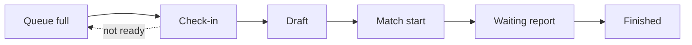
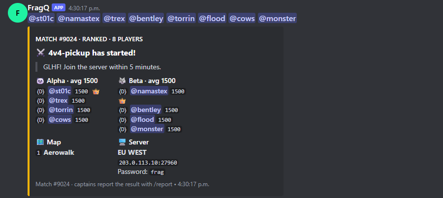

# Matches

When a queue is full (and **Start when full** is on), FragQ turns the players into a match. A match goes
through these stages; which ones apply depends on the [queue settings](../reference/queue-settings.md).

## Check-in

With **Require check-in** (`check_in_timeout`) set, FragQ posts a check-in message and pings the players.
Each player confirms within the time limit:

| Action | Command | Reaction |
|---|---|---|
| I'm ready | `!ready` / `!r` / `/ready` | ☑ |
| I'm not ready | `!notready` / `!nr` / `/notready` | ⛔ |
| Vote for a map | | 1️⃣ 2️⃣ 3️⃣ … (when **Vote poll map count** is set) |

Players who aren't ready in time are removed and the others go back into the queue, which waits for
replacements. With **Allow discard check-in** a player can drop out with ⛔; **Check-in discard
immediately** decides whether that cancels the check-in right away.

`!auto_ready 30m` (or `/auto_ready`) confirms your next check-in automatically, for up to the
channel's **Auto ready limit** (`max_auto_ready`).

## Teams

**Pick teams** (`pick_teams`) decides how teams are made:

| Value | How |
|---|---|
| `draft` | Two captains pick players in turn, following **Teams picking order** (`abababba` by default) |
| `matchmaking` | FragQ balances the teams by rating |
| `random teams` | Random teams |
| `no teams` | Just a list of players |

During a draft:

| Command | What it does |
|---|---|
| `!pick <player>` / `!p` / `/pick` | The captain whose turn it is picks a player |
| `!capme` / `/capme` | Give up your captain spot |
| `!capfor <team>` / `/capfor` | Become captain of a team |
| `!teams` / `/teams` | Show the teams so far |

**Pick captains** (`pick_captains`) decides who the captains are: by captain role and rating, a fair
pair with close ratings, random, or nobody (captains volunteer with `!capfor`).

## Match start

FragQ posts the [match start message](../queue-panel/match-message.md): the teams with their ranks and
ratings, the maps, the server address and the queue's start message. Players can also get a direct
message (`/switch_dms` turns those off for you).

{ .shot loading=lazy width=600 }

## Substitutes

| Command | What it does |
|---|---|
| `!subme` / `/subme` | You need a substitute. Run it again to cancel. |
| `!subfor <player>` / `/subfor` | Take the place of a player who asked for a substitute |

Moderators can swap any player with `/match sub_player` or move one with `/match put`.

## Reporting the result

Unranked matches are finished as soon as they start. On **ranked** queues (which need teams, so not
`no teams`) the match waits for a report, made by a team captain (the first player of each team):

| Command | What it does |
|---|---|
| `!report_loss` / `!rl` / `/report loss` | Your team lost |
| `!report_draw` / `!rd` / `/report draw` | Offer a draw; the other captain confirms with the same command |
| `!report_cancel` / `!rc` / `/report abort` | Offer to cancel; the other captain confirms |

Moderators can report any result with `/match report`, cancel a match with `!cancel_match`, and undo a
finished match with `/stats undo_match`. A ranked match that is never reported times out after the
queue's **Match lifetime** (3 hours by default).

## Other commands

| Command | What it does |
|---|---|
| `!matches` / `/matches` | Matches in progress on the channel |
| `!lastgame` / `!lg` / `/lastgame` | The last match, or the last one of a queue or player |
| `/maps`, `/map` | List a queue's maps, or print a random one |
| `/server` | Show a queue's server |
| `/cointoss` | Toss a coin |

Next: [Ratings and leaderboard](ratings.md).
