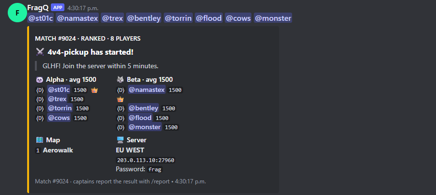

# Match start message

When a match starts, FragQ posts a message with everything the players need. FragQ has its own layout;
the original PUBobot2 layout is still available.

{ .shot loading=lazy width=600 }

## What it shows

- **The players are pinged** above the message. Mentions inside a Discord embed don't notify anyone, so
  FragQ puts them in the message text (*Ping players on match start*, `match_ping`).
- **The header**: match number, ranked or not, and the number of players.
- **The queue's start message** (`start_msg`), quoted, for example *GLHF! Join the server within 5
  minutes.*
- **The teams side by side**, with the team emojis and names, their average rating and, per player, the
  rank, the rating and 👑 for the captain.
- **The maps**, numbered.
- **The server**: the queue's **Server** setting (`server`), one line at a time:

    | Line | Shown as |
    |---|---|
    | Ends with `:` (`EU WEST:`) | A bold heading |
    | `Name: value` (`Password: frag`) | The name, then the value in a copyable code box |
    | No digits (`EU WEST`) | Bold text |
    | Anything else (`203.0.113.10:27960`) | A copyable code box |

    So this server setting:

    ```text
    EU WEST
    203.0.113.10:27960
    Password: frag
    ```

    shows a bold *EU WEST*, the address in a box you can copy with one click on desktop or a long press
    on mobile, and the password in its own box. Links are left as links.

- **The footer**: how to report the result (ranked queues) and the start time.

## Classic layout

Channel settings → **Messages** → *Match start message* (`match_embed_style`): `modern` (the FragQ layout)
or `classic` (the original PUBobot2 layout). *Ping players on match start* only applies to the modern
layout.

## Direct messages

Players also get a direct message when their match starts: the queue's **Start direct message**
(`start_direct_msg`), or a default one. Players who don't want these use `/switch_dms`.
