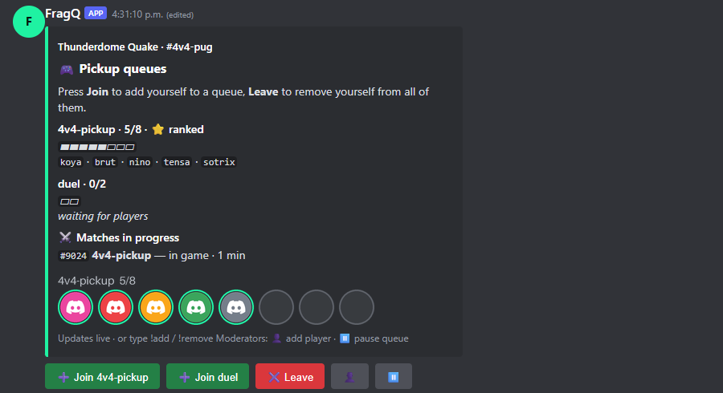

# The queue panel

The queue panel is a Discord message with a button for every queue. Players join and leave with one
click instead of typing commands, and the message always shows who is in which queue.

{ .shot loading=lazy width=600 }

## What it shows

- **One field per queue**: the name, how full it is (`5/8`), ⭐ for ranked queues, a progress bar and the
  players.
- **Matches in progress** on the channel, with their stage (check-in, draft, in game) and how long
  they've been running.
- **Player avatars**: a row of profile pictures per queue, with empty rings for the open places. Players
  with a [linked Steam account](../playing/steam.md) show their Steam avatar, others their Discord
  avatar. Queues over 8 players get another row of 8 (up to 24 places are drawn).
- **The buttons**: ➕ Join per queue (**Join *name*** when there are
  several), ✖️ Leave, and the two
  [moderator buttons](moderators.md) 👤 and ⏸️.
- **The footer** reminds players of `!add` / `!remove` and explains the moderator icons, because
  Discord buttons can't show tooltips.

The panel updates itself whenever someone joins, leaves, a match starts or finishes. A full queue's
**Join** button turns grey until there is room again.

## Post it

Any of these, by someone with the channel's **Admin role** (or *Queue panel* access in the web panel):

- **Post queue panel** on the channel page in the web panel.
- `!panel` in the channel.
- `/channel panel` (action *post*).

There is one panel per channel. Posting it again moves it to the bottom of the channel: the old message
is deleted and a new one is posted. The panel is remembered across restarts.

## Keep it visible

By default the panel is **re-posted below the match message** every time a match starts, so it doesn't
get buried under the match. Turn that off with Channel settings → **Messages** → *Keep queue panel at the
bottom* (`panel_repost`). You can also move it down at any time with **Move panel down** in the web panel or
`!panel` again.

For busy channels, the bot owner can turn on **Auto-repost queue panels** on the
[Settings page](../administration/settings-page.md#auto-repost-queue-panels): every few minutes (5 by
default), any panel that chat has pushed up is moved back to the bottom. Panels that are still the
latest message stay where they are.

## Remove it

**Remove panel** in the web panel, `!panel off`, or `/channel panel` with action *remove*. Deleting the
message in Discord works too; FragQ notices and stops updating it.

## Replies are private

Button presses are answered with messages only the player sees (the queue they joined and who is in
it, or why they couldn't join), so the channel isn't flooded. `!add`, `++` and `/add` keep working as before and
reply in the channel.

## Avatar cache

FragQ downloads each avatar once and keeps it in the data volume (`/data/avatars`), so the panel picture
is drawn without fetching from Steam or Discord every time. Pictures that haven't been used for 30 days
are deleted automatically.
