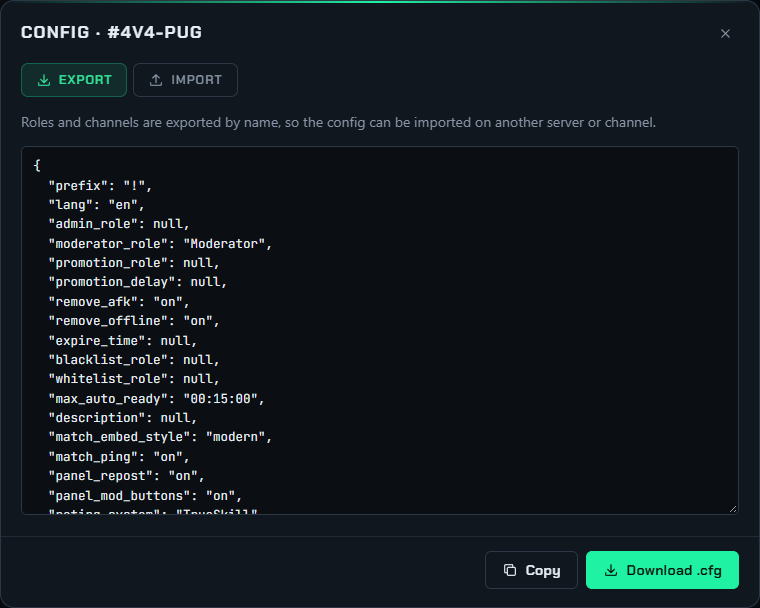

# Import and export

Channel and queue settings can be copied as JSON `.cfg` files: to back them up, to set up a new channel
like an existing one, or to move a configuration to another server. The format is the same as the
original PUBobot2 web interface used, so configs exported from PUBobot2 import into FragQ.

{ .shot loading=lazy width=760 }

## Export

Press **Import / export** on a channel or queue page (or choose **Import / export config** in its **⋯**
menu). The **Export** tab shows the configuration; **Copy** puts it on the clipboard, **Download .cfg**
saves it as a file.

Roles and channels are exported **by name**, not by id, so the file also works on another server that
has roles with the same names.

## Import

On the **Import** tab, paste a configuration or press **Load file…** to open a `.cfg` file, then press
**Import**. Only the variables in the file are changed; everything else keeps its value. Roles and
channels are looked up by name (or id), and the whole import is checked first: if any value is invalid,
nothing is changed and the errors are listed.

The Import tab needs *Edit channel settings* or *Edit queue settings*; with only *View* you can export.

## From chat

The same JSON works in chat:

```text
!set_channel_cfg {"prefix": "!", "remove_afk": "off"}
!set_queue_cfg 4v4-pickup {"size": "10", "map_count": "2"}
```

## Example

A queue `.cfg` file looks like this (shortened):

```json
{
  "name": "4v4-pickup",
  "size": "8",
  "is_default": "on",
  "ranked": "on",
  "check_in_timeout": "00:05:00",
  "pick_teams": "draft",
  "pick_order": "abababba",
  "team_names": "Alpha Beta",
  "server": "EU WEST\n203.0.113.10:27960\nPassword: frag",
  "maps": [{"name": "Aerowalk"}, {"name": "Campgrounds"}],
  "aliases": [{"alias": "4v4"}]
}
```
