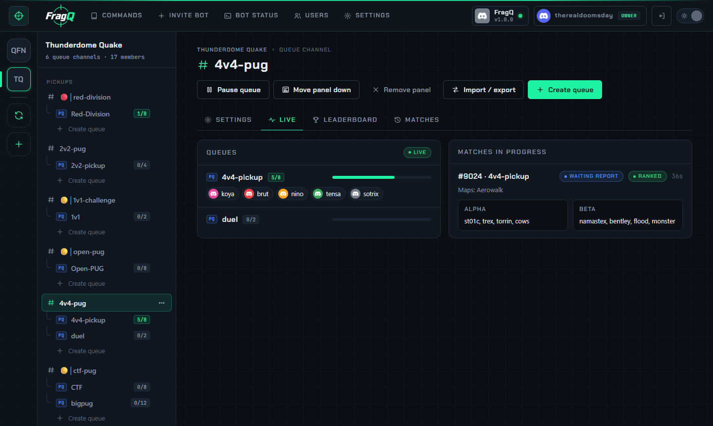
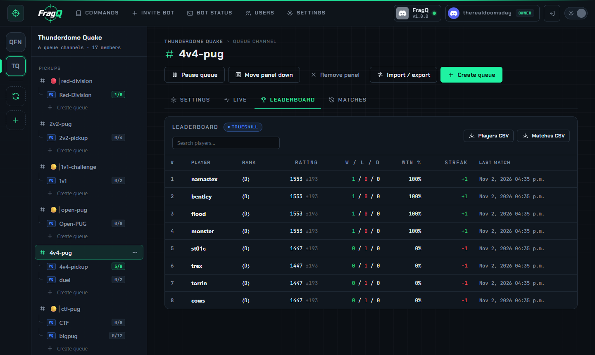
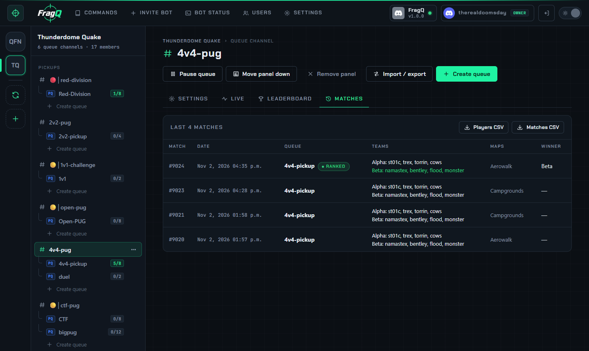

# Live, leaderboard and matches

## Live

A channel's **Live** tab shows each queue with its players and how full it is, and the matches in
progress. It updates by itself while you look at it. The server overview shows the same for all
channels of a server.

{ .shot loading=lazy }

## Leaderboard

The **Leaderboard** tab lists the channel's players by rating, with the rating system in use. Each row
shows the rank, the rating with its deviation (`1553 ±193`), wins / losses / draws, the win rate, the
current win or loss streak and the last match. Type in **Search players…** to filter by name.

{ .shot loading=lazy }

## Matches

The **Matches** tab is the channel's recent match history, newest first: match id, date, queue, the
teams, the maps and the winner.

{ .shot loading=lazy }

## CSV downloads

**Players CSV** and **Matches CSV** on both tabs (also **Export players / matches (CSV)** in the
channel's **⋯** menu) download:

| File | Contents |
|---|---|
| **Players CSV** | One row per player: id, nick, rating, deviation, wins, losses, draws, streak, hidden, last ranked match |
| **Matches CSV** | One row per match: id, time, queue, ranked, winner, team names and scores, maps, and the players of each team |

The files open in Excel, LibreOffice or Google Sheets.

The Leaderboard and Matches tabs and the CSV downloads need the *Stats* permission; see
[Web panel access](../administration/access.md).
