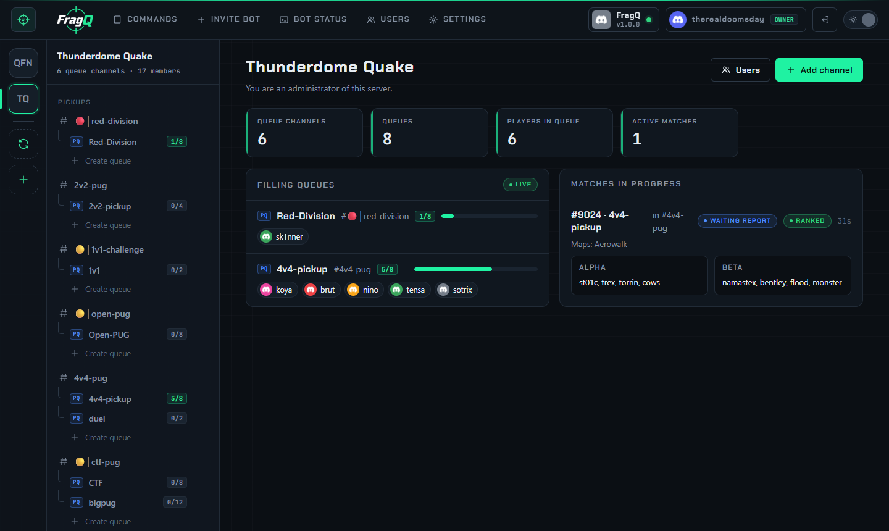
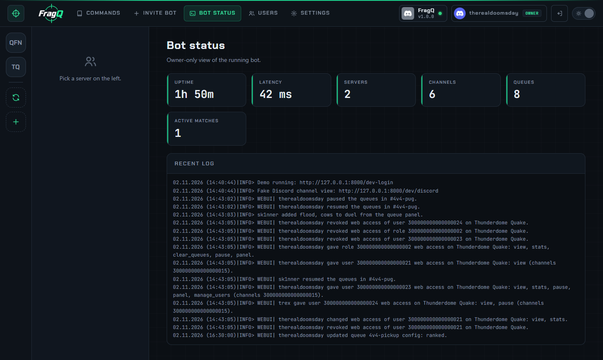
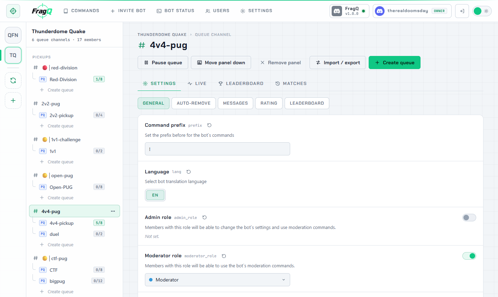

# Navigating the panel

The web panel is at your `PUBLIC_URL`. Sign in with Discord; you only see the servers and channels you
have access to (see [Web panel access](../administration/access.md)).

{ .shot loading=lazy }

## Layout

| Area | What is there |
|---|---|
| **Top bar** | **Commands** (the [command reference](../reference/commands.md) in this documentation), **Invite bot**, and, depending on your access, **Bot status**, **Users**, [**Connectors**](../connectors/index.md) and **Settings** (with a count when Steam account changes wait for you). On narrow windows the links show as icons, with the name as a tooltip. On the right: the bot's connection status, your account, sign out, and the light/dark theme switch. |
| **Server rail** | One button per server you can manage. **Refresh server list** reloads it (after you got access somewhere new); **+** opens the bot invite. |
| **Channel tree** | The enabled channels of the selected server, with their queues and how full they are. **Add channel** enables the bot on another channel; **Create queue** adds a queue to a channel. The **⋯** menu on a channel or queue has the less common actions. |
| **Main area** | The page you selected. |

Every page has its own address, so you can bookmark a channel's leaderboard or share a link to a queue's
settings with another admin.

## Server overview

Select a server to see its numbers (queue channels, queues, players in queue, active matches), the
queues that are filling up, and the matches in progress with their teams and state. **Users** opens the
[Users page](../administration/access.md) for that server; **Add channel** enables the bot on a channel.

## Channel page

Select a channel in the tree. The buttons at the top:

| Button | What it does |
|---|---|
| **Pause queue** / **Resume queue** | Stop or allow joining on the whole channel. See [Moderator buttons](../queue-panel/moderators.md#pause-queue). |
| **Post queue panel** / **Move panel down** | Post the Discord [queue panel](../queue-panel/panel.md), or move it below the latest messages |
| **Remove panel** | Delete the queue panel from Discord |
| **Import / export** | Copy the channel's settings as a `.cfg` file. See [Import and export](import-export.md). |
| **Create queue** | Add a queue to this channel |

And four tabs:

- **Settings**: every [channel setting](../reference/channel-settings.md), in sections. See
  [Channel and queue settings](settings-editor.md).
- **Live**: the queues and matches in progress, updated as they change.
- **Leaderboard** and **Matches**: ratings and match history, see
  [Live, leaderboard and matches](live-and-stats.md).

The channel's **⋯** menu in the tree also has **Duplicate**, **Export players (CSV)**, **Export matches (CSV)** and
**Disable bot on channel**. **Duplicate** asks for another text channel, like **Add channel**, and enables
the bot there with the same settings and a copy of every queue. Players, ratings, match history and the
queue panel aren't copied. Disabling deletes the channel's configuration and queues; ratings and match
history stay in the database, so enabling the channel again later brings them back.

## Queue page

Select a queue in the tree to edit its [settings](../reference/queue-settings.md). Its **⋯** menu has
**Duplicate**, **Import / export config**, **Remove all players** and **Delete queue**. **Duplicate** adds a
queue with the same settings on the same channel, named like `4v4(Copy)` (queue names can't contain spaces);
rename it in its settings. Deleting a queue keeps its match history.

## Bot status

The bot owner gets a **Bot status** page: uptime, Discord latency, the number of servers, channels,
queues and active matches, and the recent log.

{ .shot loading=lazy }

## Light and dark theme

The switch at the right of the top bar changes the theme; your choice is remembered in the browser.

{ .shot loading=lazy }
