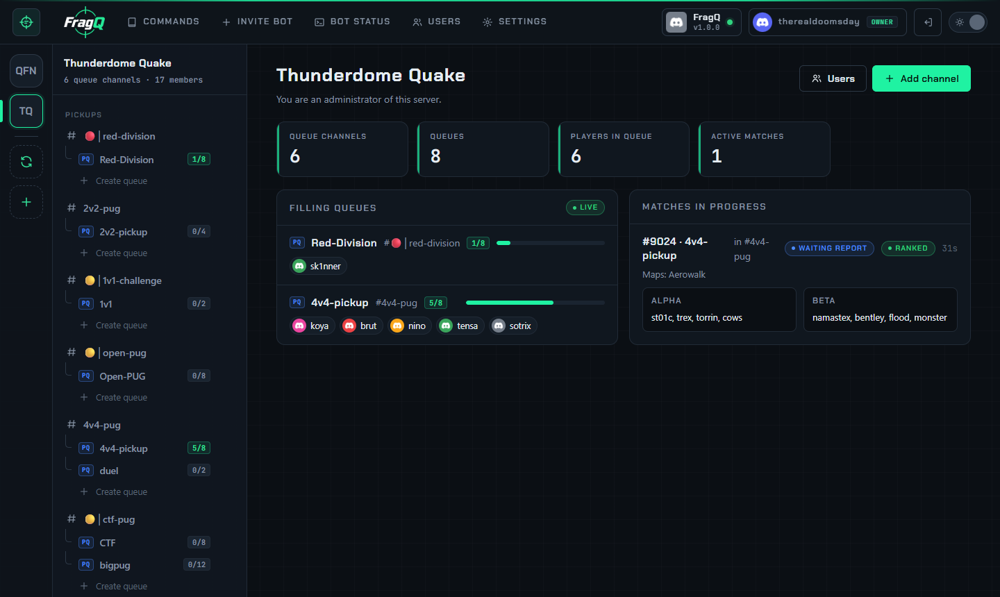
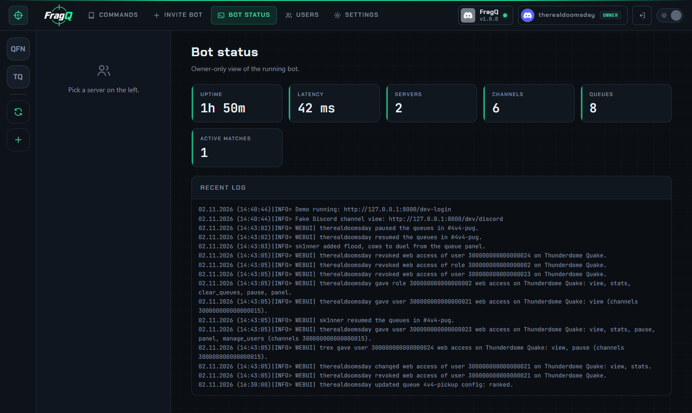
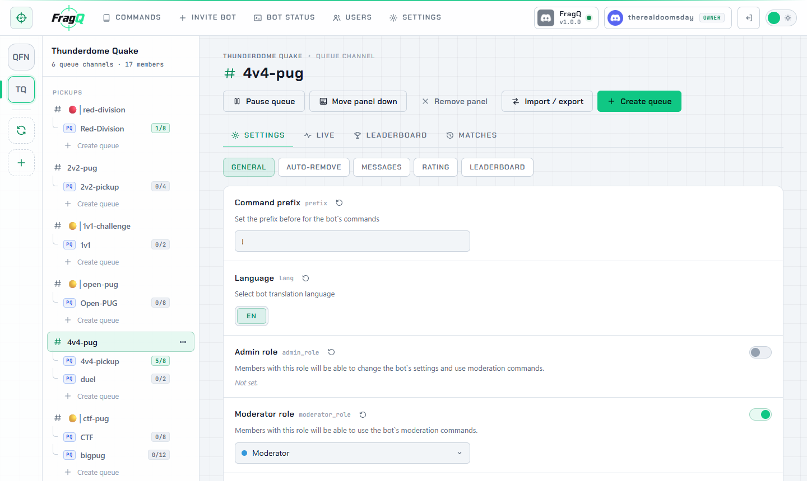

# Navigating the panel

The web panel is at your `PUBLIC_URL`. Sign in with Discord; you only see the servers and channels you
have access to (see [Web panel access](../administration/access.md)).

{ .shot loading=lazy }

## Layout

| Area | What is there |
|---|---|
| **Top bar** | **Commands** (the [command reference](../reference/commands.md) in this documentation), **Invite bot**, and, depending on your access, **Bot status**, [**QueueGen**](../administration/queuegen.md), **Users**, [**Connectors**](../connectors/index.md) and **Settings** (with a count when Steam account changes wait for you). On narrow windows the links show as icons, with the name as a tooltip. On the right: the bot's connection status, your account, sign out, and the light/dark theme switch. |
| **Server rail** | One button per server you can manage. **Refresh server list** reloads it (after you got access somewhere new); **+** opens the bot invite. |
| **Channel tree** | The enabled channels of the selected server, with their queues and how full they are. **Add channel** enables the bot on another channel; **Create queue** adds a queue to a channel. The **⋯** menu on a channel or queue has the less common actions. |
| **Main area** | The page you selected. |

Every page has its own address, so you can bookmark a channel's leaderboard or share a link to a queue's
settings with another admin.

## Server overview

Select a server to see its numbers (queue channels, queues, players in queue, active matches), the
queues that are filling up, and the matches in progress with their teams and state. **Users** opens the
[Users page](../administration/access.md) for that server; **Add channel** enables the bot on a channel.

## Channel page

Select a channel in the tree. The buttons at the top:

| Button | What it does |
|---|---|
| **Import / export** | Copy the channel's settings as a `.cfg` file. See [Import and export](import-export.md). |
| **Create queue** | Add a queue to this channel |

The title shows *Paused* when every queue of the channel is paused, or *1 of 3 paused*. Pausing a queue and the
queue panel buttons are on each [queue page](#queue-page).

And five tabs:

- **Settings**: every [channel setting](../reference/channel-settings.md), in sections. See
  [Channel and queue settings](settings-editor.md).
- **Server List**: the channel's game servers, see [Server List](#server-list) below.
- **Live**: the queues and matches in progress, updated as they change.
- **Leaderboard** and **Matches**: ratings and match history, see
  [Live, leaderboard and matches](live-and-stats.md).

## Server List

The channel's **Server List** tab holds its game servers, one per line, as `IP:port`, such as
`131.153.224.87:27970`. A host name instead of the IP works too (`thepurgery.com:27960`). Each server can have a
**label** of up to 40 characters, such as *CA #1 (Chicago)*, to tell them apart; labels are only shown in the web
panel, never in Discord.

The servers' fields are locked: press ✏ next to a server to change its address or label (✓ locks it again), and
the 🗑 button to take it off. **+ Add server** adds a new, open line. Press **Save** to keep the changes.
Addresses without a port, with spaces or other characters in them are refused, and duplicates are kept once. The
list needs the *Edit channel* permission to change; anyone who can see the channel can read it.

Each queue can then **designate a server** from the list, in the drop-down next to its name (queue **Settings →
General → Designate a server for this queue (optional)**), which shows each address with its label
(*131.153.224.87:27970 — CA #1 (Chicago)*). When a match of that queue starts, the designated
server's address (not its label) comes first in the match's server information, above the queue's own **Server** text
(**Appearance**), so the message shows it as a copyable address. The same text goes into the queue's start
direct message (`{server}`) and `/server`. Without a designated server, matches show only the **Server** text,
as before.

- Next to each server, the list says which queues designated it. Taking a designated server off the list asks
  first; the queues keep their choice (the drop-down shows it as *not on the Server List*), but their matches
  stop showing it until it is added back or they pick another one.
- The list is the channel setting `servers` and the queue's choice the queue setting `designated_server`, so both
  go along with [Import and export](import-export.md), **Duplicate** and settings backups. A PUBobot2 config has
  neither and leaves them as they are.

The channel's **⋯** menu in the tree also has **Duplicate**, **Export players (CSV)**, **Export matches (CSV)** and
**Disable bot on channel**. **Duplicate** asks for another text channel, like **Add channel**, and enables
the bot there with the same settings and a copy of every queue. Players, ratings, match history and the
queue panel aren't copied. Disabling deletes the channel's configuration and queues; ratings and match
history stay in the database, so enabling the channel again later brings them back.

## Queue page

Select a queue in the tree to edit its [settings](../reference/queue-settings.md). Above its settings tabs:

| Button | What it does |
|---|---|
| **Pause Queue** / **Queue paused** | Stop or allow joining **this queue**; the channel's other queues stay open. See [Moderator buttons](../queue-panel/moderators.md#pause-queue). |
| **Post queue panel** / **Refresh Panel** | Post the channel's Discord [queue panel](../queue-panel/panel.md), or refresh it and move it below the latest messages |
| **Remove panel** | Delete the channel's queue panel from Discord |

A channel has one queue panel for all of its queues, so **Refresh Panel** and **Remove panel** do the same from any
of the channel's queue pages. A paused queue shows *Paused* in its title and ⏸ in the tree.

Its **⋯** menu has **Duplicate**, **Pause Queue** / **Resume queue**, **Import / export config**, **Remove all
players** and **Delete queue**. **Duplicate** adds a
queue with the same settings on the same channel, named like `4v4(Copy)` (queue names can't contain spaces);
rename it in its settings. Deleting a queue keeps its match history.

## Bot status

The bot owner gets a **Bot status** page: uptime, Discord latency, the number of servers, channels,
queues and active matches, and the recent log.

{ .shot loading=lazy }

## Light and dark theme

The switch at the right of the top bar changes the theme; your choice is remembered in the browser.

{ .shot loading=lazy }
