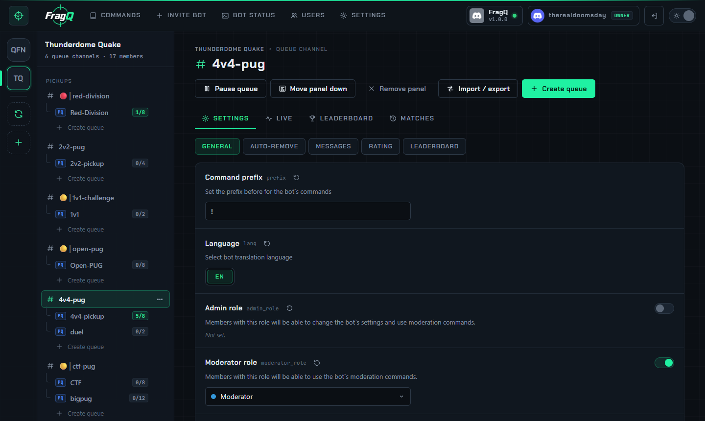
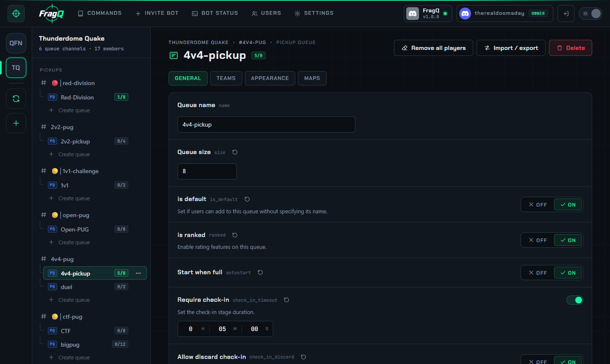

# Channel and queue settings

The web panel edits the same settings as `/channel set` and `/queue set`, with a description, the
right input and a reset button for each. Changes go through the bot's own validation and apply
immediately, exactly as if they were typed in chat.

{ .shot loading=lazy }

## Editing

1. Select a channel (for channel settings) or a queue (for queue settings) in the channel tree.
2. Pick a section: **General**, **Auto-remove**, **Messages**, **Rating** and **Leaderboard** for
   channels; **General**, **Teams**, **Appearance** and **Maps** for queues.
3. Change values. A bar at the bottom counts the unsaved changes.
4. Press **Save changes**, or **Discard** to undo them. If you leave the page with unsaved changes,
   the panel asks first.

If a value is rejected, the setting is marked with the bot's error message and nothing is saved.

## Inputs

| Type | Input |
|---|---|
| Text, numbers | A text box |
| On / off | A switch |
| Choice | Buttons or a list with the allowed values |
| Role, channel | A searchable list of the server's roles or text channels |
| Duration | Text such as `1h 30m`, `45m` or `00:15:00` |
| Percent | A slider |
| Tables (maps, aliases, ranks) | Rows you can add, edit and remove |

Settings that can be empty have a switch: off means *not set*, and the bot uses its default
behaviour. The ↺ button next to a setting's name resets it to the default.

{ .shot loading=lazy }

## Read-only view

Members with [web panel access](../administration/access.md) but without *Edit channel settings* or
*Edit queue settings* see the settings read-only, with a note at the top. They can still export them.

## Settings reference

Every setting, with its variable name, type, default and description:

- [Channel settings](../reference/channel-settings.md)
- [Queue settings](../reference/queue-settings.md)
